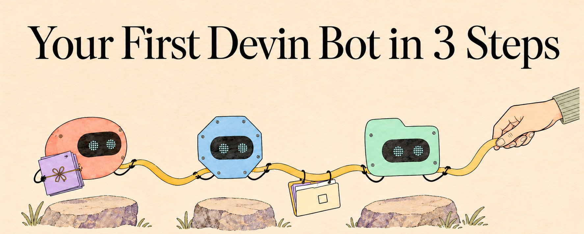
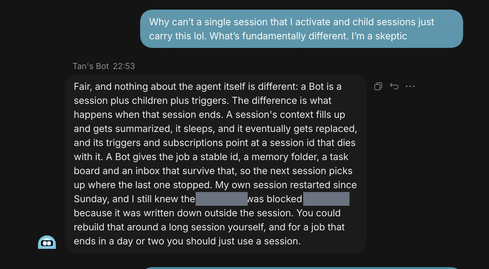
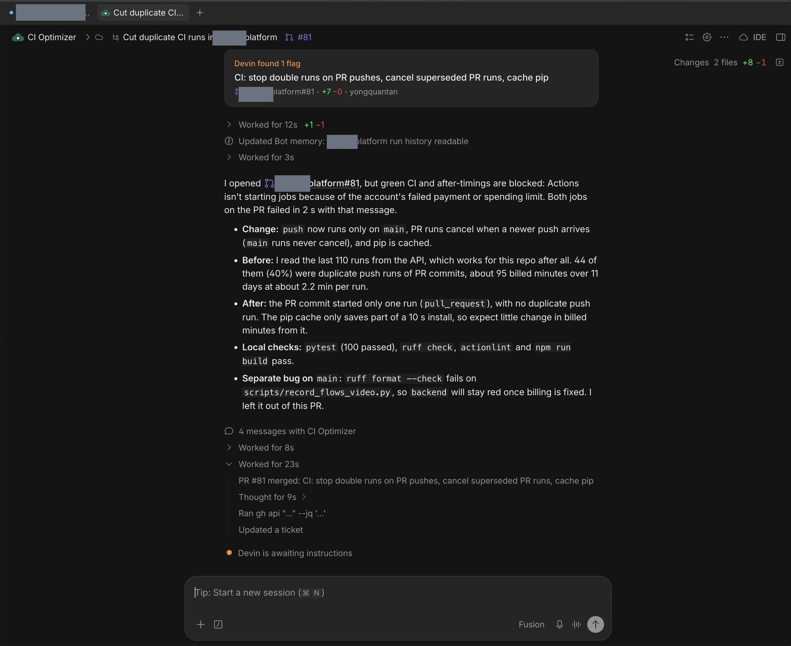
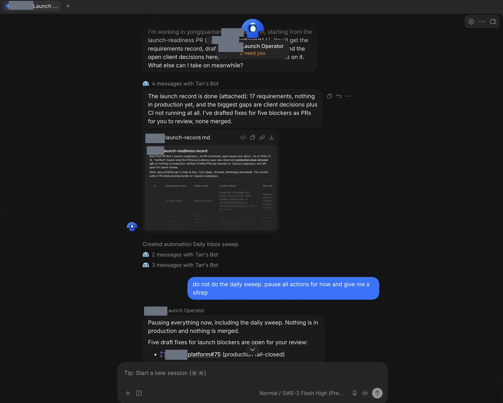
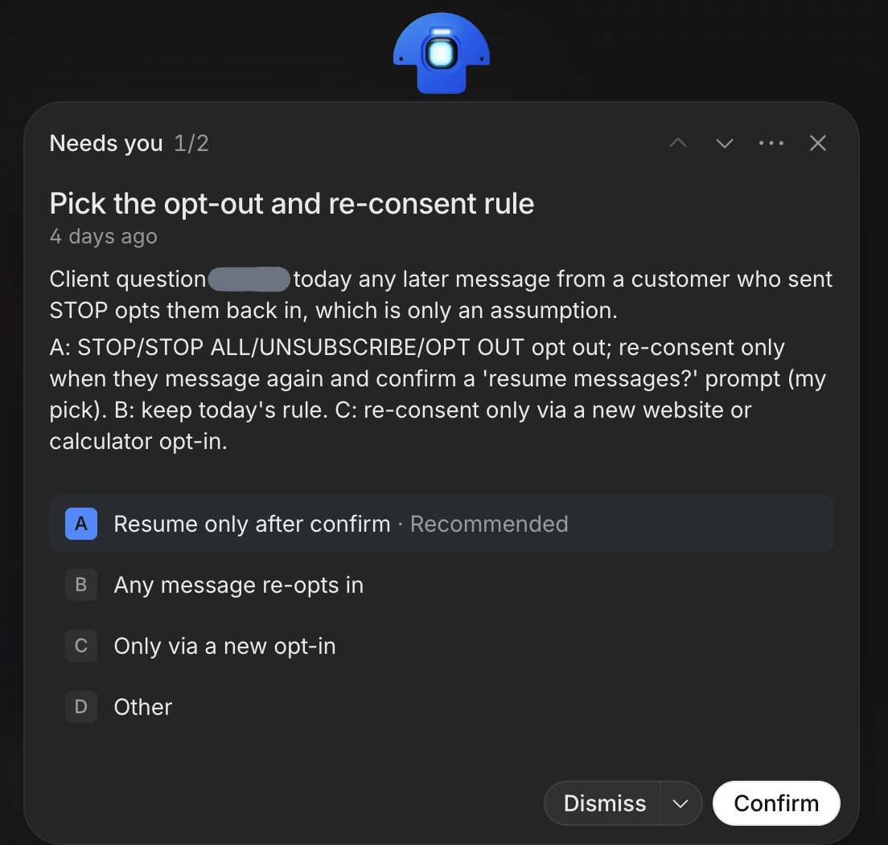
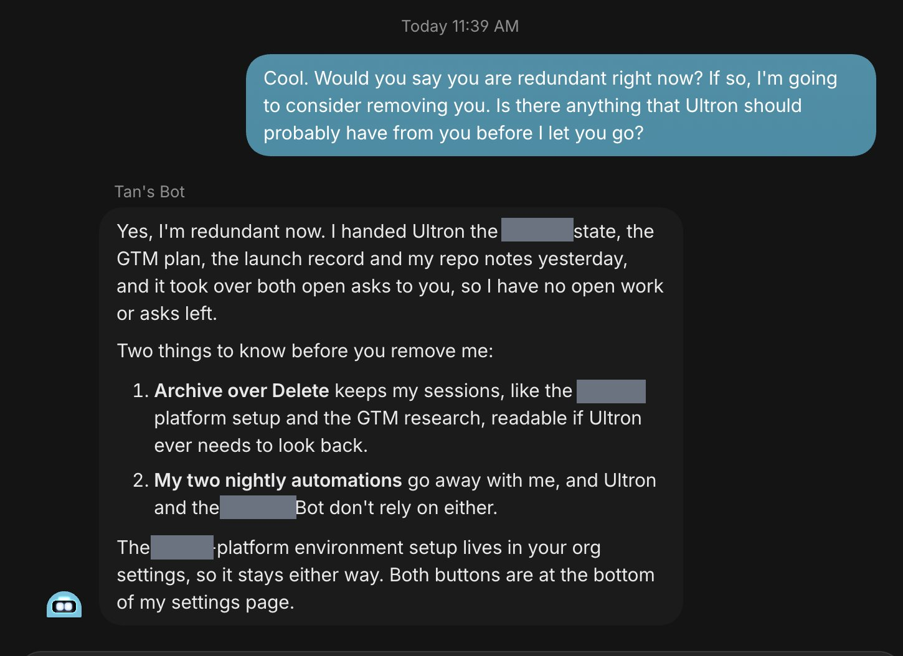
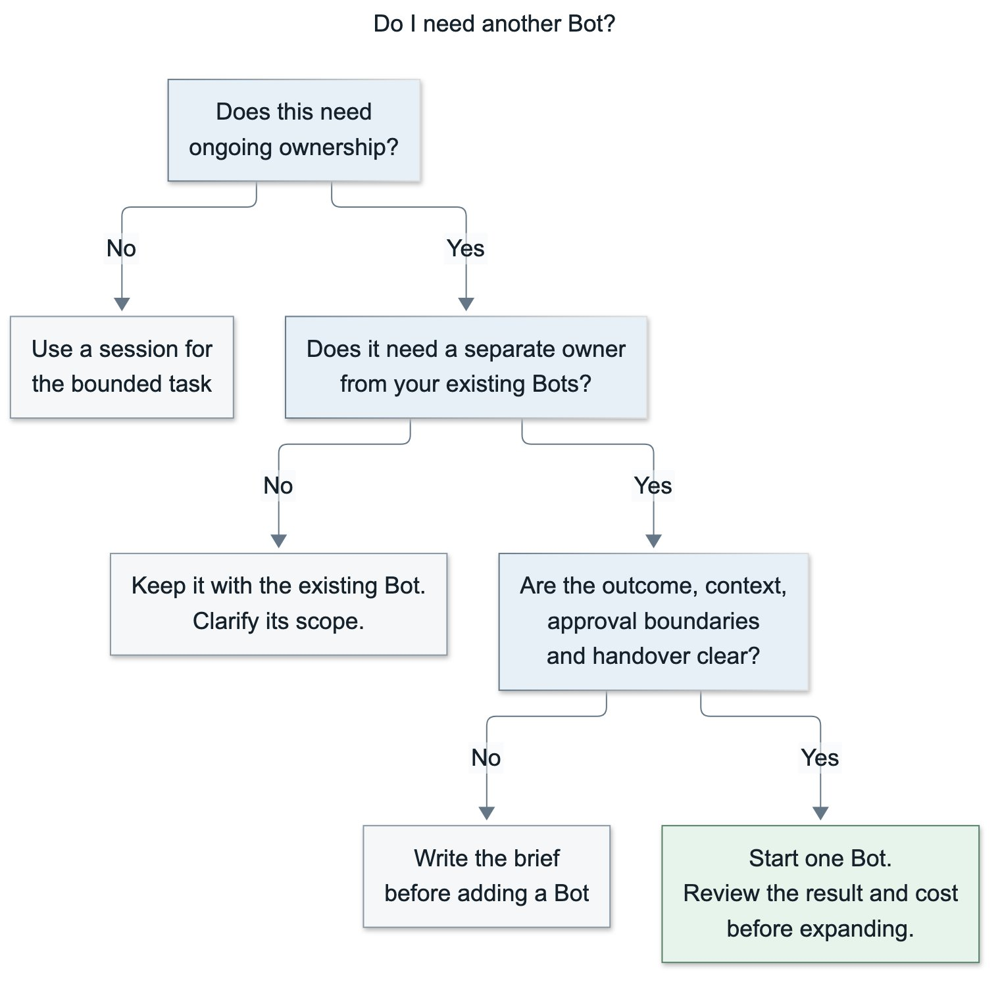

# Your First Devin Bot, in 3 Steps

Three days ago I sat on my phone interrogating a Devin Bot like it owed me money.

"Why can't a single session I activate, plus child sessions, just carry this? What's fundamentally different. I'm a skeptic."

I already use coding agents every day. I didn't want another wrapper with a personality. The answer surprised me, mostly because it agreed with me.

Yes. It's the same model. It's a session, plus children, plus triggers.

The useful difference is what survives: a stable identity, shared memory, connections, a task board, open asks, and follow-through when a PR merges or a child session finishes.

You can build that around sessions yourself. A docs folder in your repo already covers part of it. What interested me was having it packaged into something I could give a continuing responsibility to.

Here's how I'd start with job-specific Bots, with relevant access and responsibilities. The first three steps take you through a useful first result and a follow-up. After that, I'll show how I expanded the team.

## 1. Start with one job that keeps coming back

Pick work you keep meaning to return to: CI cleanup, a launch checklist, something that quietly gets worse when nobody owns it. Start with one Bot and one responsibility.

Give it a concrete outcome, the repo or project it should work in, and a way to tell whether it's making progress. A starting brief:

> Own CI waste in this repo. Start by inspecting recent runs and identifying one source of wasted work or recurring failure. Show the evidence, propose the smallest useful fix, and explain how we'd verify it. Preserve test coverage. Report what you couldn't access and what remains blocked. Ask me before merging or changing billing settings.

My CI optimizer Bot found 44 of the last 110 runs on one repo were duplicate push runs of PR commits: 40%. Its fix stopped the double runs, cancelled superseded PR runs and cached pip. The PR merged. On that commit, CI started one run instead of two.

But don't stop at "PR opened." Ask for the before/after, the limitations, and the next unresolved thing.

Mine caught a format error on main, pushed back on an "only test what changed" idea because it cuts coverage, and kept flagging a billing problem that was stopping Actions from running. Private repos it couldn't read stayed unmeasured.

A session could do those checks too. The value for me was keeping the unresolved work on its list across sessions, without rebuilding the follow-up loop myself.

## 2. Give it context and a clear approval boundary

On its first night, my launch Bot scheduled itself a daily sweep.

It was going to check its open asks, the task board and the launch work every morning and only message me if something needed me. That's a reasonable thing for an owner to do.

I said no anyway: "do not do the daily sweep. pause all actions for now and give me a sitrep."

The launch record it built on the first pass already had what I needed: 17 requirements, 10 decisions waiting on the client, five draft fixes. Another job running every day would only add noise on top of that.

You can apply the same approach to other responsibilities. My client-launch example shows why the boundaries matter:

> Build and maintain a launch-readiness record from the repo, issues and PRs. For each requirement, show what's implemented, where it's verified, and what's still blocked. Surface decisions that need me or the client. Don't contact the client, merge, deploy or change production without my approval. Ask before creating recurring automations.

That experience is why I'd make the automation boundary explicit from the start. Owning an outcome still includes escalating decisions to the person who has authority to make them.

## 3. Review what the Bot brings back to you

Once you give it the responsibility, the Bot comes back with progress, blockers and decisions that need you. You don't need a separate prompt telling it to save its state or produce a status report every time.

In my setup, the launch Bot came back with a "Needs you" update after the five fixes were merged. It recognised that the PRs were merged, and surfaced the remaining client decisions with recommendations.

The Bot flagged an open client question sitting on an assumption: today, if a customer sends STOP, any later message from them, even "hi", opts them back in. It worked. Nobody had decided it should.

So it didn't change the code. It turned the rule into a card with three options and its pick: treat STOP, UNSUBSCRIBE and OPT OUT as opt-outs, and only resume when the customer messages again and confirms a "resume messages?" prompt.

That isn't an engineering call. It's about how the client treats their customers, so it came to me with a recommendation instead of a pull request.

Your part is to answer the card.

## When you're ready to expand

The first three steps are enough to start. Expand once the first Bot is doing useful work and you can see where another responsibility needs its own owner.

### Split responsibilities when one Bot gets too broad

I started with a general-purpose Bot. Eventually it held too much, so I moved its responsibilities to a new hub Bot.

The handover is worth making explicit:

> Hand over your current responsibilities, memory notes, plans, open asks and next steps to the receiving Bot. Confirm what it has accepted and what still belongs to you. Tell me what happens to your automations and history if I retire you.

Mine handed over its memory notes, plans, a launch record and two open asks. When I asked whether it was redundant now, it said yes. It recommended archiving so its old sessions stayed readable, and explained that its two nightly automations would go away with it.

I've seen plenty of agents open PRs. Watching one make itself redundant without losing the work was more interesting.

That's when it clicked for me: I can reshape a team of these without losing what they knew.

### Grow the team around responsibilities

I ended up with about six Bots: Chief of Staff, automation, community, a personal assistant, GTM, and the CI optimizer. To be honest, I probably only need four for now.

Give each new Bot a job you can describe, context it can use, and a clear handover point with the others. In my setup, Bots propose new Bots and I approve each one on a card. They open PRs and start sessions on their own. Merges on my products, deploys, production changes and messages to other people wait for my yes.

Watch the cost as you expand. Token usage was higher than I expected because Bots spin up their own cloud sessions. Choose work worth delegating, and check whether the follow-through is actually reducing yours. Idle Bots cost nothing.

Before adding another Bot, here's the decision I'd work through as a practical rule of thumb:

## Try it on one repo

Pick one engineering responsibility you keep having to revisit.

Give a Bot a clear outcome, the context it needs, and explicit approval boundaries. Aim to leave the first session with something you can inspect: a finding backed by evidence, a reviewable fix, or a clear blocker.

Then give it a decision and see whether it carries the work forward. Start with that loop before growing the team.

Did it move the work forward, or did you still have to chase it?

## Set yourself up — hand your agent this:

1. Check whether a Chief of Staff bot already exists. If one does, figure out where you'd fit under it. If not, start there: the Chief of Staff owns the task board, the open asks, and the follow-through between the bots and the owner.
2. Define the specialised bots under it, based on the real work — the repos, boards and tools you can actually see, not this article's roster. For each bot: the job in one line, the context it needs, its approval boundaries, and its handover point.
3. Boundaries for every bot: no merges, deploys, production changes, messages to other people, billing changes, or recurring automations without the owner's explicit yes. Propose, don't create.
4. Share your proposal — the Chief of Staff brief, the roster, what access each bot needs — and don't start working until it's approved.
